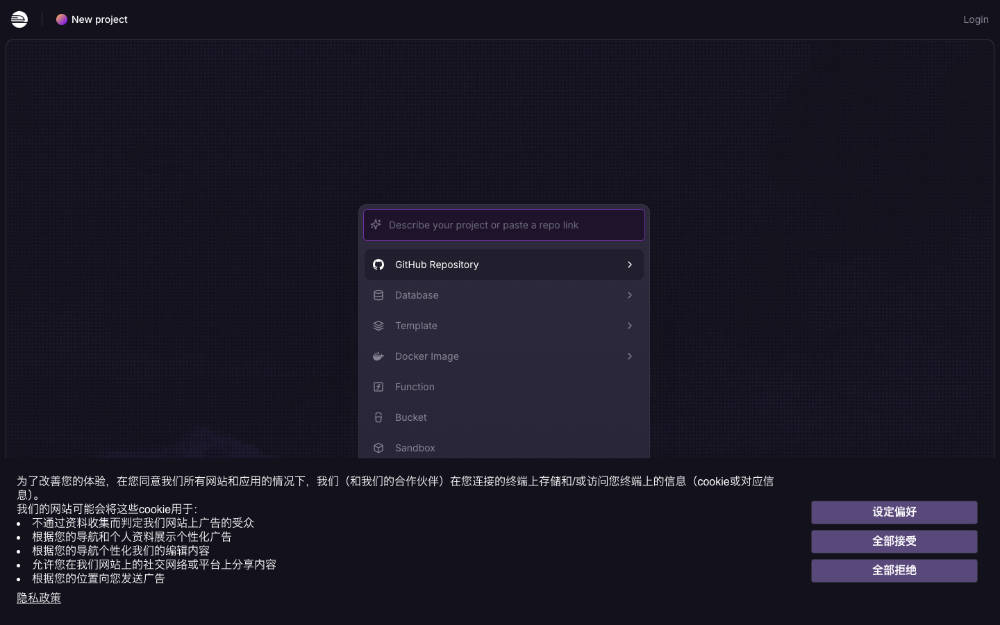

# 部署到公网：手把手操作手册

> 目标：拿到一个公网链接（形如 `https://yusong-production-xxxx.up.railway.app`），发给别人就能访问并多人协作。

---

## ✅ 你的进度

| 步骤 | 状态 |
|---|---|
| 第 1 步 在 GitHub 创建仓库 | ✅ 已完成（`github.com/ruanyusong1996/yusong`） |
| 第 2 步 推送代码 | ✅ 已完成（远程 main 分支已有 2 个提交） |
| **第 3 步 Railway 部署** | ⬅ **你在这里** |
| 第 4 步 生成公网链接 | 待做 |
| 第 5 步 挂磁盘保数据 | 待做（强烈建议） |

**从第 3 步开始照着做就行。**

---

# 第 3 步：在 Railway 部署（★ 2026 最新界面）

> ⚠️ **你找不到界面，是因为 Railway 改版了**：旧教程里的 "Deploy from GitHub repo" 已经**改名为 "GitHub Repository"**，而且整个页面布局也换了。

## 3.1 先登录

1. 打开 👉 **https://railway.com/new**
2. 页面底部会弹出一长条 **cookie 提示**（中文）→ 点右边的 **「全部接受」** 关掉它
3. 看**右上角**的 **Login** → 点它
4. 在弹出页选 **Continue with GitHub**（用 GitHub 账号一键登录，不用另注册）
5. 第一次会跳到 GitHub 问「Authorize Railway」→ 点绿色 **Authorize** 按钮

## 3.2 创建项目

登录后再次打开 👉 **https://railway.com/new**

页面正中间会出现这样一张卡片（就是下面截图的样子）：



框里从上到下是：

| 位置 | 选项 | 说明 |
|---|---|---|
| ① 顶部输入框 | **Describe your project or paste a repo link** | 偷懒通道：直接粘仓库链接 |
| ② 第一个卡片 | **GitHub Repository** | ← **点这个**（就是旧版的 "Deploy from GitHub repo"） |
| ③ | Database / Template / Docker Image / Function / Bucket / Sandbox | 都不点 |

**两种走法，任选一种：**

### 走法 A（最快，推荐）

直接在 **① 那个输入框** 里粘贴你的仓库地址，回车：

```
https://github.com/ruanyusong1996/yusong
```

### 走法 B（常规）

点 **② GitHub Repository** → 弹出仓库列表 → 找到 **`yusong`** → 点它

> 如果列表是空的、并提示 "Configure GitHub App"，说明 Railway 还没拿到你 GitHub 仓库的权限：
> 点 **Configure GitHub App** → 选 **Only select repositories** → 勾上 `yusong` → **Save** → 再回到 `railway.com/new` 重来。

## 3.3 开始部署

- 如果弹出配置页，直接点右下角 **Deploy Now**（**不用改任何设置**，`railway.toml` 已经替你配好了）
- Railway 自动执行：装依赖 → 识别为 Node 项目 → 跑 `node server.js`
- 等 **1～2 分钟**，直到日志里出现这几行白字：

```
海底捞集团工会工作数据看板 - 后端服务
数据文件:   /app/server-data.json
Server listening on http://0.0.0.0:xxxx
```

看到 `Server listening` 就说明服务跑起来了 ✅

---

# 第 4 步：生成公网链接

服务跑起来还只是内网，要手动开个公网门：

1. 在项目画布上**点一下你的服务卡片**
2. 顶部标签切到 **Settings**
3. 往下翻，找到 **Networking** 区块
4. 点 **Generate Domain** 按钮
5. 几秒后出现一行地址，形如 `yusong-production-xxxx.up.railway.app`
6. 点右边的**复制按钮** —— 这就是你要发出去的链接

访问方式：

- 📊 看板：`https://yusong-production-xxxx.up.railway.app/`
- ⚙️ 后台：`https://yusong-production-xxxx.up.railway.app/admin.html`

把链接发给同事，他们打开就能看、也能直接改数据，改动会实时同步给所有人。

---

# 第 5 步：挂一块磁盘，让数据永不丢失（★ 必做）

> **为什么必须做**：Railway 免费层在你长时间不访问后会把容器重启一遍，重新部署时镜像里的
> `/app` 目录被整体替换 —— 数据文件写在里面就会退回初始的 20/13/7。挂一块 Volume 才彻底解决。

## 5.1 在哪里创建 Volume（找不到入口就看这里）

Volumes **不在 Settings 里**，官方入口只有这两个（任选其一）：

| 入口 | 具体操作 |
|---|---|
| **命令面板**（最快） | 在项目页面按 **`⌘K`**（Windows 是 `Ctrl+K`）→ 输入 `volume` → 选 **Create Volume** |
| **画布右键** | 在项目画布的**空白处点右键** → **Volume** |

创建时会让你**选择要挂到哪个服务**，选你的那个服务，然后**必须填 Mount path**：

```
/data
```

填完确认，Railway 会自动重启一次服务让挂载生效。

> **另一个能看到 Volume 的地方**：点开你的**服务** → **Variables** 标签 → 往下滚，
> 底部有 **Volumes** 区域，已挂上的卷会列在这里（这个区域只在已经有卷时才有内容，
> 所以第一次创建必须走上面的 `⌘K` 或右键）。

> ⚠️ **免费层每个项目最多只能有 1 个 Volume**。如果你在 `⌘K` 里找不到 Create Volume，
> 通常就是额度已经用掉了 —— 那就说明项目里已经有卷了，去画布上看有没有一个 Volume 节点，
> 把它**连到你正在用的那个服务**即可，不用再新建。

## 5.2 环境变量

回到服务 → **Variables** → **+ New Variable**，加一条（如果还没有）：

| 变量名 | 值 |
|---|---|
| `DATA_DIR` | `/data` |

> **v1.2 起即使忘了设这个变量也不会丢数据**：程序启动时会自动探测 `/data`
> （Railway Volume 的默认挂载点），存在且可写就直接使用；同时会到各个候选目录里
> 把已有的数据/配置/密码文件「认领」回来，不会因为环境变量写错就换成空目录。

改完变量 Railway 会自动重新部署一次。等它跑完就齐活了 —— 以后不管重新部署多少次，数据都还在。

### 怎么确认持久化真的生效了？

**方法一（不用敲网址）**：登录后台 → **🔒 安全设置 → 💾 数据存储与备份**，看第一行：

| 显示 | 含义 |
|---|---|
| 🟢 **数据持久化：已开启** | 正常，重新部署/重启容器都不会丢数据 |
| 🔴 数据持久化：未开启 | 危险，数据写在临时目录；同时页面顶部会弹红色告警条 |

**方法二（命令行）**：打开 `https://<你的域名>/api/health`，看这两个字段：

| 字段 | 含义 |
|---|---|
| `persistent` | `true` = 数据写在不随部署消失的目录里；`false` = 有丢数据风险 |
| `storageMode` | `env`（DATA_DIR 指定）/ `volume`（自动识别到 /data）/ `app-data`（代码目录下的 data/，危险）/ `app-root`（代码目录本身，危险） |

> **只要 `persistent` 是 `false`，后台顶部就会常驻一条红色告警条**，写明「数据写在临时目录、
> 重新部署后会丢失」，并直接告诉你补救办法（挂持久卷 + 挂载路径填 `/data`）。
> 这是 v1.2.1 加的「不许静默失败」机制 —— 以前它不报错、不提示，只是悄悄地每次部署都退回种子数据，
> 所以问题拖了很久才被发现。
>
> ⚠️ 注意：**挂了卷之后再重新部署，服务会有十几秒到一分钟的短暂中断**（Railway 为防止数据损坏，
> 不允许两个部署同时挂载同一个卷）。这期间网址打不开是正常的，等它自己起来就好。

后台 → **🔒 安全设置 → 💾 数据存储与备份** 里有更完整的信息（数据目录、最近写入时间、行数、快照数量），
并且可以直接点「恢复」把数据回滚到任意一份自动快照。

---

## 数据"被清空"了怎么办？（v1.2 起有救）

**原因**：数据文件之前写在代码目录里，而平台每次重新部署都会替换掉代码目录 ——
文件没了，启动时又用种子数据重新初始化，看起来就是"数据被清空、退回初始 20/13/7"。

**v1.2 的三道保险**：

1. **存储目录自动识别**：优先 `DATA_DIR`，其次 `/data`（Volume），再是代码目录；启动日志会明确打印
   `✅ 数据存储在持久目录中` 或 `⚠️⚠️ 警告：数据写在「代码目录」里`。
2. **每次写入前自动快照**：数据与看板配置各保留最近 40 份，存在 `<数据目录>/backups/`。
3. **一键恢复**：后台 → 🔒 安全设置 → 💾 数据存储与备份 → 找到要回滚的时间点 → 点「恢复」。

**另外还加了两道防呆**：

- 探不到后端时，前端**不再悄悄显示示例数据**（以前会被误当成"数据被清空"），而是明确报错 + 顶部橙色横幅提示。
- 提交「空数据」或「会把全部行清空」的写入，服务端直接拒绝（400），防止误操作把数据抹掉。

---

## ⚠️ 关于费用：Railway 免费层额度很小

Railway 现在**没有永久免费**了，只有：

| 计划 | 额度 | 说明 |
|---|---|---|
| Free Trial | $5 一次性，30 天有效 | 新账号自动给 |
| Free | **$1 / 月** | 试用到期后自动转这个 |
| Hobby | $5 / 月 | 含 $5 用量额度 |

你这个服务很轻（Node + 42KB 数据），空闲时内存约 100MB 左右：

- 内存成本 ≈ 0.1GB × $10/GB/月 ≈ **$1 / 月**

也就是说**刚好卡在免费层的 $1 额度边缘**，可能够、也可能偶尔超一点点。真跑起来后可以去 **Settings → Usage** 看实际消耗。

**如果不想操心**，随时可以切到别的平台（见文末）。

---

## 常见问题排查

| 现象 | 原因 | 解决 |
|---|---|---|
| 打开 railway.com/new 只有营销页，没有卡片列表 | 没登录 / 没关 cookie 弹窗 | 先点右上角 **Login** → Continue with GitHub；再点「全部接受」 |
| 仓库列表里找不到 `yusong` | Railway 没拿到 GitHub 权限 | 点 **Configure GitHub App** → 勾选 `yusong` → Save |
| 部署失败，日志 `Cannot find module 'express'` | 依赖没装上 | 等它自动重试；或 Service → 右上 **⋯** → **Redeploy** |
| 部署成功但链接打不开 | 忘了 Generate Domain | 回到第 4 步 |
| **找不到 New Volume / Create Volume** | Volumes 不在 Settings 里 | 按 **5.1** 走：`⌘K` → 输入 `volume`，或画布空白处右键 → Volume（免费层每项目限 1 个） |
| **网址偶尔打不开，过一会儿又好了** | 正在重新部署/重启，容器在替换 | 正常现象，等十几秒到一分钟；挂了卷之后每次部署都会有这段短暂中断 |
| 数据用着用着变回 20/13/7 | 容器重建丢数据（数据写在代码目录里） | 做第 5 步挂 Volume；然后打开 `/api/health` 确认 `persistent: true`。已经丢了的话，去后台 安全设置 → 💾 数据存储与备份 里找快照恢复 |
| `/api/health` 显示 `persistent: false` | 没挂 Volume，或挂载路径不是 `/data` | 按第 5 步挂 Volume（路径填 `/data`），再设 `DATA_DIR=/data`，重新部署 |
| 后台顶部出现红色告警条 | 数据写在临时目录，随时会丢 | 见告警条上的提示，按 **5.1** 挂卷，路径填 `/data` |
| 页面能开但一直显示"本地存储"徽章 | 前端没连上后端 | 确认日志里没有报错、`/api/health` 能打开 |

---

## 如果 Railway 还是走不通，换这几个平台（都更快）

| 平台 | 免费额度 | 特点 |
|---|---|---|
| **Zeabur** | 每月 $5 credits | 有**香港/新加坡节点**，国内访问快很多，中文界面，步骤和 Railway 几乎一样 |
| **Render** | 真免费 | 但 15 分钟无访问会休眠，唤醒要等 30 秒 |
| **Fly.io** | 有免费额度 | 需要命令行操作 |

**Zeabur 尤其值得考虑** —— 你这个是中文团队协作场景，HK/SG 节点延迟能低 100～150ms，体验差别很明显，而且 $5/月的免费额度比 Railway 的 $1 宽松 5 倍。

需要我换到 Zeabur 或者帮你把数据存进数据库（彻底不依赖磁盘），直接说。

---

部署完成拿到链接后，把链接发我，我帮你验证多人协作效果（同时改、跨地区访问）。
